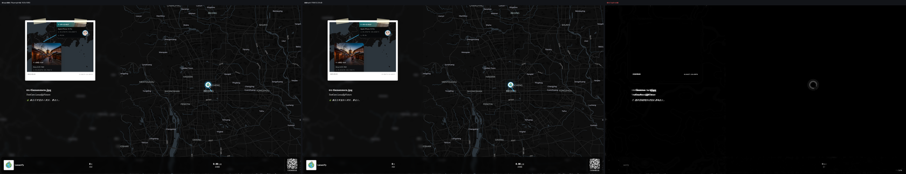
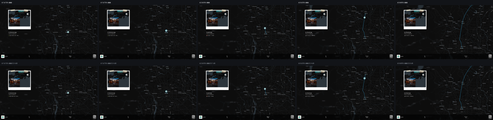
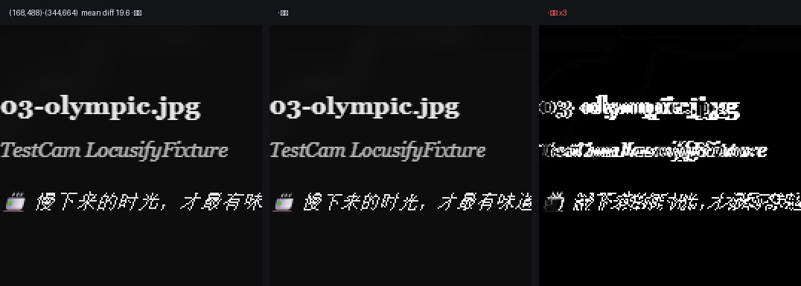
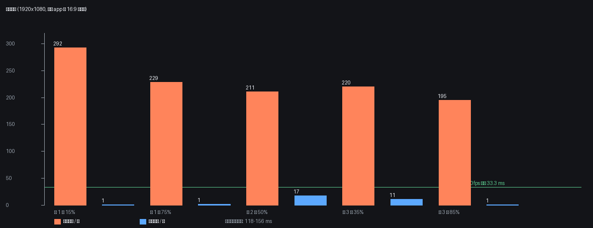

# 视频导出：用真实 app 跑出来的对比评测

> 上一版报告里的效果图是我**手搓的复刻场景**，不是你的产品，已被否定。这一版全部重做：跑的是仓库里的真实 app，像素来自 app 自己的组件、字体、地图样式和真实照片。

## 0. 这次测的是什么

| 项目 | 说明 |
| --- | --- |
| 被测页面 | `packages/app` 真实 dev server（`vite --port 1070`），`/zh-CN/` 地图页 |
| 真实交互 | 点侧栏「上传照片」→ 真实上传抽屉 → 选 `packages/app/e2e/fixtures` 里 4 张**带 EXIF GPS 的真实照片**（天安门 / 鼓楼 / 奥林匹克 / 慕田峪）→ 真实解析 EXIF → `route-create` 生成 4 个 marker |
| 真实回放 | 点侧栏「查看轨迹」→ 真实 `prepareReplay()` 建 3 段路径 → 真实 `replayStore` 驱动 |
| 唯一 mock | `/api/v1/{auth/me,profile,subscriptions}` 三个鉴权响应（和仓库自带 e2e 一致），与画面无关 |
| 抓取目标 | app 自己录屏用的那个 16:9 容器（`MapSection.tsx` 的 `cropRef`，运行时实测 `1920×1080 @ (0,0)`） |
| 参考图 | Playwright 对该容器直接截图 = 浏览器真实渲染结果 |
| 冻结方式 | 只把回放的时钟停住（`_tick` 置空 + 指定 `segmentProgress`），并把 `recordingActive` 打开——也就是导出视频时的那套界面；**没有改任何样式/组件** |

所以下面每一个 PSNR / SSIM 都是「离线合成出的像素」对「你的 app 此刻真实渲染出的像素」，不是对我画的东西打分。

## 1. 结论先看

1. **离线合成能到 PSNR 32.2–32.6 dB / SSIM 0.994–0.996**，平均每通道差 0.27–0.33，全画面只有 **0.14–0.16%** 的像素差值 >40。肉眼级别：地图、玻璃卡、照片、轨迹、底栏、二维码全部一致，剩下的只是文字抗锯齿的亚像素相位。
2. **瓶颈不在画质，在每帧成本**。整帧光栅（`html-to-image` 把 16:9 容器整棵树栅格化一次）要 **195–292 ms/帧 ≈ 3–5 fps**，直接淘汰。
3. **分层合成把每帧压到 0.7–16.8 ms**（中位 1 ms）：地图 canvas 直接 `drawImage`，玻璃用画布内 `blur` 现场做，静态 UI 只栅格化一次（118–157 ms，按 waypoint 排干），每帧只重画变了的文字。
4. **编码器不是瓶颈但也不快**：WebCodecs H.264 实测 90 帧 1080p30 用 2.44 s（1.23× 实时），产物 6.2 MB（≈16 Mbps）。整条离线管线的总时长 ≈ 静态层 4×130 ms + 视频时长 × 0.85。
5. **ffmpeg.wasm 不建议进主链路**：核 31 MB、GPL-2.0-or-later、实测 0.29× 实时（3.4 倍于视频时长）。留作兼容兜底即可。

## 2. 三条路线对比

| | 现状：屏幕捕获 | 离线整帧光栅 | 离线分层合成（推荐） |
| --- | --- | --- | --- |
| 实现 | `getDisplayMedia` + `CropTarget.cropTo` + `MediaRecorder`（`useVideoRecorder.ts`） | 每帧 `html-to-image` 栅格化整个 16:9 容器 | 地图 `drawImage` + 画布 `blur` 造玻璃 + 静态层缓存 + 文字补丁 |
| 与实时画面差异 | 0（就是屏幕） | 32.4 dB / 0.995 | 32.3 dB / 0.995 |
| 每帧成本 | 0（编码器实时吞帧） | **195–292 ms** → 3–5 fps | **0.7–16.8 ms** → 60+ fps 余量 |
| 10 s 片子总耗时 | ≈10 s | ≈60 s+ | ≈130 ms×N + 8.5 s |
| 需要用户授权 | 需要（选窗口/屏幕） | 不需要 | 不需要 |
| 依赖窗口尺寸/遮挡 | 是（切标签页、缩放都会坏） | 否 | 否 |
| 可自动化/可重跑 | 难 | 可以 | 可以 |
| 分辨率 | 取决于窗口 | 固定 1920×1080 | 固定 1920×1080 |
| 玻璃 `backdrop-blur` | 原生正确 | 丢失，需手工补 | 手工补，实测一致 |

## 3. 保真度（真实 app，1920×1080）

| 状态 | 路线 | PSNR (dB) | SSIM | 平均通道差 | 差值>40 的像素 |
| --- | --- | --- | --- | --- | --- |
| 第 1 段 15% | 整帧光栅 | 32.47 | 0.9958 | 0.28 | 0.15% |
| 第 1 段 15% | 分层合成 | 32.43 | 0.9952 | 0.31 | 0.15% |
| 第 1 段 75% | 整帧光栅 | 32.44 | 0.9955 | 0.29 | 0.15% |
| 第 1 段 75% | 分层合成 | 32.43 | 0.9950 | 0.32 | 0.15% |
| 第 2 段 50% | 整帧光栅 | 32.60 | 0.9958 | 0.27 | 0.14% |
| 第 2 段 50% | 分层合成 | 32.39 | 0.9953 | 0.31 | 0.15% |
| 第 3 段 35% | 整帧光栅 | 32.37 | 0.9955 | 0.30 | 0.15% |
| 第 3 段 35% | 分层合成 | 32.18 | 0.9948 | 0.33 | 0.16% |
| 第 3 段 85% | 整帧光栅 | 32.32 | 0.9957 | 0.29 | 0.15% |
| 第 3 段 85% | 分层合成 | 32.31 | 0.9952 | 0.31 | 0.15% |
| 编码回环（第 45 帧，解码 MP4 vs 送进编码器的帧） | WebCodecs H.264 | 45.08 | 0.9956 | 0.55 | 0.00% |

编码回环 45 dB 意味着 H.264 这一环几乎不引入可见损失；32 dB 那一档完全是 DOM 栅格化/文字相位的事。





## 4. 剩下的 32 dB 差在哪

把「实时 vs 分层合成」的差值按 32×32 分块聚类，全画面只有 **1 个** 区域平均差 >12：

| 区域 | 尺寸 | 平均差 | 最大差 |
| --- | --- | --- | --- |
| (192,512)–(320,640) | 128×128 | 19.6 | 218 |

放大看就是一小段文字的字形相位/抗锯齿差异（同一字号、同一字体，但 SVG `foreignObject` 里的文字光栅化相位与页面不同）。地图瓦片、玻璃卡、照片缩略图、路线、底栏数字、二维码都在 0.1% 以内。



这条也解释了为什么整帧光栅和分层合成 PSNR 几乎一样：两者都走 `html-to-image`，误差同源。

## 5. 成本

| 项目 | 实测 |
| --- | --- |
| 整帧光栅 / 帧 | 195 ms / 210.9 / 220.2 / 228.7 / 292.2（5 个状态） |
| 静态层栅格化（一次） | 117.7–156.5 ms |
| 分层合成 / 帧 | 0.7 / 0.8 / 1.0 / 11.1 / 16.8（有 1 个文字补丁时 11–17 ms） |
| 地图 `drawImage` / 帧 | 0.1–0.3 ms |
| 玻璃 blur / 帧 | 0.2–0.5 ms（本状态命中 2 个 `backdrop-filter` 元素） |
| WebCodecs 编码 90 帧 1080p30 | 2.44 s（36.9 fps 墙钟，1.23× 实时），6.2 MB，`avc1.640028` @ 16 Mbps |
| 合成（分层）/ 帧（编码期间） | p50 0.3 ms，p95 0.5 ms，max 13.3 ms |



## 6. 编码器对比（沿用复刻场景上的 300 帧基准，场景无关的那部分）

| 编码器 | 300 帧 1080p30 耗时 | 相对实时 | 产物 | 备注 |
| --- | --- | --- | --- | --- |
| WebCodecs H.264 + mediabunny MP4 | 7.4 s | 1.35× | 12.6 MB | 无额外依赖，主选；真实 app 上复测 1.23× |
| MediaRecorder VP9/WebM | 10.0 s | 1.00× | 10.1 MB | 现状兜底，实时约束 |
| ffmpeg.wasm libx264 | 34.4 s | 0.29× | 1.6 MB | 核 31 MB，GPL-2.0-or-later |

ffmpeg.wasm 的具体代价：`@ffmpeg/core@0.12.10` 单线程核 **31 MB**（`ffmpeg-core.js` + `ffmpeg-core.wasm`），可以避开 COOP/COEP 与 SharedArrayBuffer；许可证 **GPL-2.0-or-later**，Web 端分发需要把它当独立可替换组件、并满足 GPL 的源码/声明义务。它唯一的优势是产物小、兼容老浏览器。

## 7. 建议

1. **生产路线走分层合成 + WebCodecs**：不要每帧整棵树栅格化，那 200+ ms 是死路。
2. **静态层在导出前排干**：3 个 waypoint → 4 个静态状态，各 130 ms 左右；排干后再开始编码，避免录制中途出现 130 ms 卡顿。
3. **玻璃必须手工补**：SVG `foreignObject` 里 `backdrop-filter` 没有背面可采样，只有把地图先画进画布、再对该区域 `ctx.filter='blur(Npx)'` 自绘，才能和实时一致。
4. **文字补丁只重画变了的叶子节点**（`textContent` 变化的最小元素），实测 11–17 ms/帧，仍在 33 ms 预算内。
5. **ffmpeg.wasm 只作按需兜底**（Safari/旧内核/需要极小体积时），不进主链路。
6. **屏幕捕获保留**：作为「用户就要 100% 原样、且愿意授权」的兜底，或画布内容过于复杂时的降级路径。

## 8. 还能再压的部分

- 剩余 32 dB 里几乎全是文字相位：自托管 `Inter` 字形 + `-webkit-font-smoothing: antialiased` 统一后重测，预期能再抬 1–2 dB；但收益只在数字上，肉眼已无差别。
- 静态层目前按「状态」重做；若能拿到 waypoint 到达事件，可在到达瞬间后台预栅格化下一状态，做到零卡顿。
- 输出分辨率目前锁 1920×1080（`cropRef` 是 `aspect-video`）；若产品要 4K，需要 `pixelRatio: 2` 重测成本。

## 9. 复现

```bash
# 1) 起真实 app
cd packages/app && npx vite --port 1070 --strictPort

# 2) 跑真实 app 的导出基准（约 3 分钟：真实上传、真实回放、5 个冻结状态 + 90 帧编码）
cd tools/export-bench/real && node run-real.mjs

# 3) 只重算指标和四张图（不启浏览器）
python tools/export-bench/real/figures-real.py
```

产物落在 `shots/real/`（截图 + `clip-webcodecs.mp4` + `metrics.json`，已 gitignore），报告数据副本在 `reports/export-bench/metrics-real.json`、`fidelity-real.json`。

## 10. 文件

| 路径 | 作用 |
| --- | --- |
| `tools/export-bench/real/flow.mjs` | 真实 app 启动、真实上传、真实回放、时钟冻结 |
| `tools/export-bench/real/composer.ts` | 页面内合成器：整帧光栅 / 分层合成 / 玻璃手工 blur / 文字补丁 / WebCodecs 编码 |
| `tools/export-bench/real/run-real.mjs` | 主基准脚本 |
| `tools/export-bench/real/figures-real.py` | 由 PNG 反推指标并生成四张图 |
| `tools/export-bench/src/webcodecs.ts`、`src/decode.ts` | 编码/解码工具（被复刻场景基准与真实 app 基准共用） |
| `reports/export-bench/report.html` | 同一份报告的 HTML 版 |

> 旧的复刻场景基准已从报告里移除，只保留在 git 历史与 `tools/export-bench/artifacts/`（gitignored）里作为编码器基准来源。
